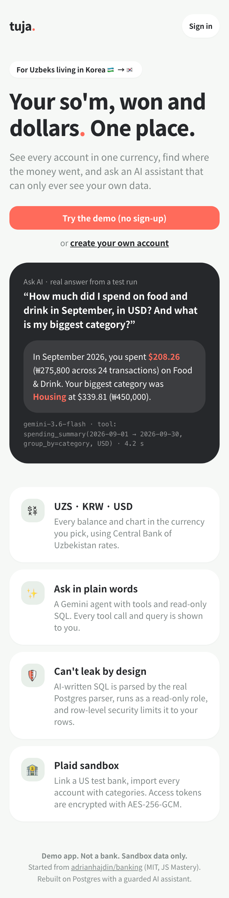
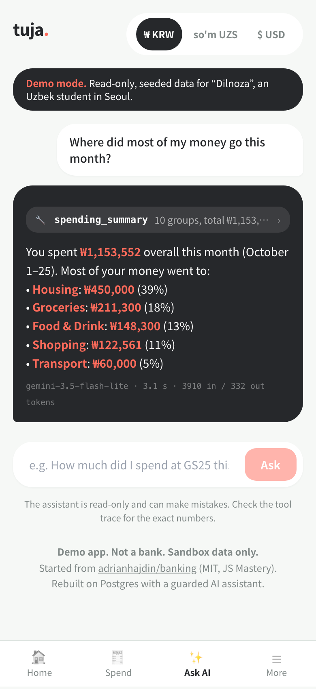
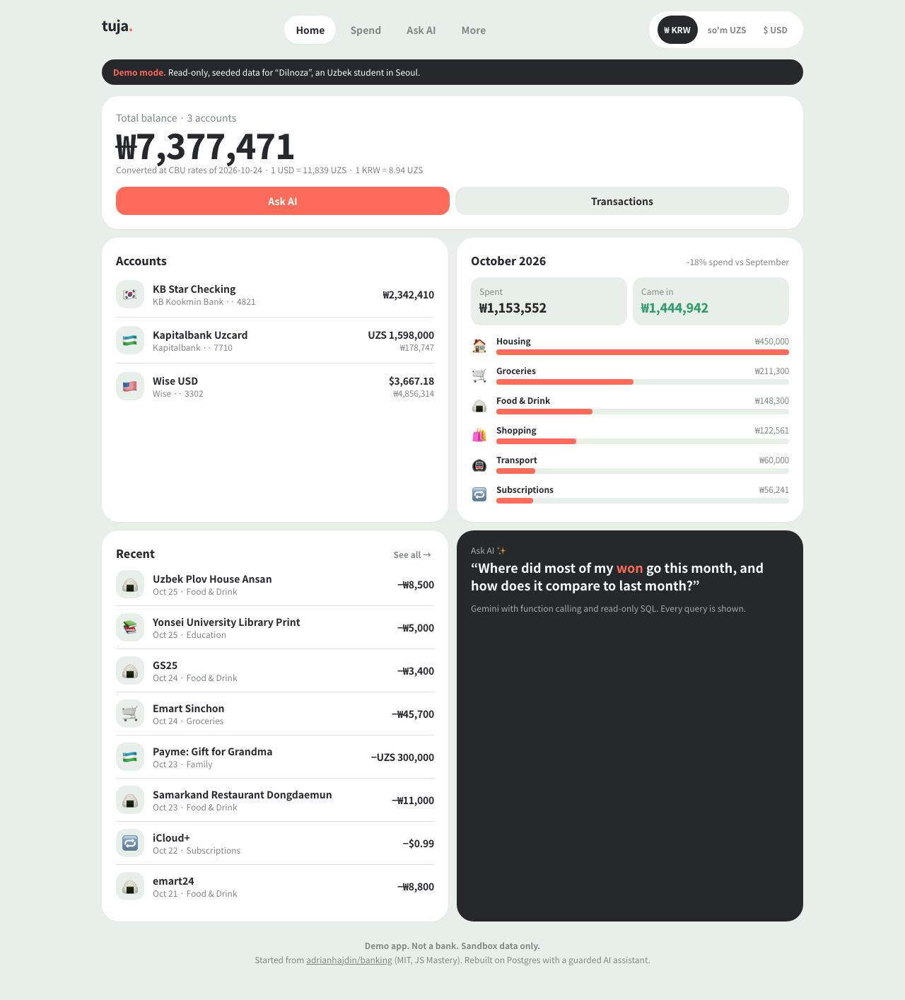
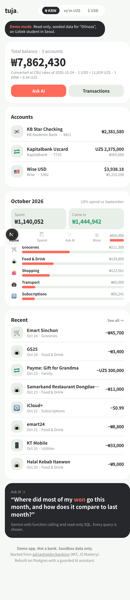
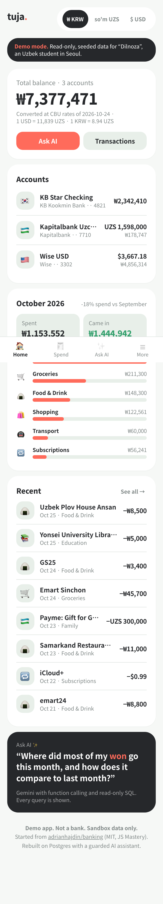
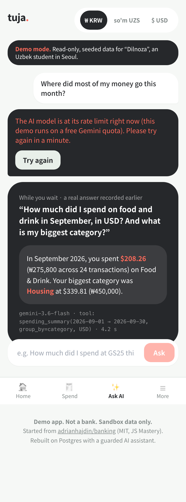
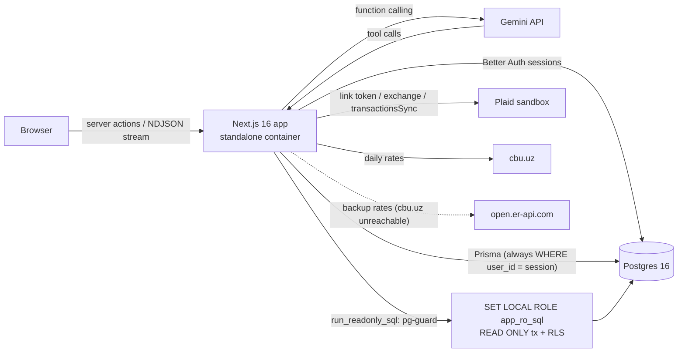

# Tuja

**Multi-currency money app (UZS · KRW · USD) with a Gemini assistant whose SQL physically cannot leave the current user's rows.**

Live demo: **https://tuja.azbek.me** (click "Try the demo", no sign-up)

> Demo app. Not a bank. Sandbox data only.

Tuja started from JS Mastery's [Horizon tutorial](https://github.com/adrianhajdin/banking) (MIT). I imported it untouched as the first commit, tagged it [`upstream-baseline`](../../tree/upstream-baseline), and everything after that is my own work: see `git diff upstream-baseline..master`. I found security bugs in the tutorial and fixed them, replaced Appwrite with Postgres, and added multi-currency support, an evaluated AI agent and a guarded Text-to-SQL engine.

<p align="center">
  
  
  
</p>

The demo persona is Dilnoza, an Uzbek master's student in Seoul. Her parents send so'm from Tashkent, rent and food are paid in won, and her subscriptions and freelance income are in dollars. About 16–18k Uzbek students live in Korea, and no existing app shows UZS and KRW side by side.

---

## What I built on top of the tutorial

### Bugs and security problems found in the tutorial → fixed

| # | Problem in Horizon | Fix in Tuja |
|---|---|---|
| B1 | **Broken Plaid transactions sync**: the loop never passed `cursor`, so it re-fetched page 1 and overwrote the array (the "transactions not showing" issues) | Cursor loop that appends every page and restarts from the first cursor on `TRANSACTIONS_SYNC_MUTATION_DURING_PAGINATION`. Unit-tested (`tests/plaid.test.ts`) |
| B2 | Link token asked only for `auth`, so Transactions failed with a consent error | Requests the `transactions` product with 180 days of history |
| B3 | Used Plaid's deprecated `category` field (empty) | Uses `personal_finance_category`, mapped to app categories |
| B4 | **IDOR**: `?id=` from the URL loaded any user's bank, balances and transactions | Every query is filtered by the session user's id; account ids from the URL are used only if they belong to that user |
| B5 | **SSN collected and stored in plain text** | No SSN is collected at all |
| B6 | Plaid `access_token` stored in plain text | AES-256-GCM with random IV and auth tag (`src/lib/crypto.ts`), tamper test included |
| B7 | "Encryption" of shareable ids was base64 | Removed; ownership checks instead of obscured ids |
| B8 | Only `accounts[0]` of each Plaid item was used | All accounts of an item are imported (sandbox check: 14/14) |
| B9 | Errors swallowed with `console.log`; pages crash on null user | Typed JSON errors, auth guard in the layout, empty states |
| B10 | `ignoreBuildErrors` / `ignoreDuringBuilds`; a Sentry org hardcoded | Strict TypeScript build; Sentry removed |
| B11 | 27 vulnerable production deps (2 critical, 14 high) on Next 14.2.3 | Next 16.4 / React 19.3 / Plaid 49: `npm audit --omit=dev` now reports 3 moderate, 0 high, 0 critical |
| - | Appwrite Cloud free tier pauses idle projects after 7 days, which kills a portfolio demo | Self-hosted Postgres 16 in Docker next to the app |

### New features

| Feature | Where |
|---|---|
| Postgres + Prisma 7 schema; money stored as `amount_minor BIGINT` + ISO currency | `prisma/schema.prisma` |
| Better Auth email/password; auth HTTP routes limited to `get-session`/`sign-out` so nobody can change the public demo password | `src/lib/auth.ts`, `src/app/actions/auth.ts` |
| One-click **read-only demo** with ~300 deterministic transactions over 6 months, including a prompt-injection memo. It reseeds itself once a day (UTC) so the data always ends today: checked on demo requests, one reseed across all processes via a Postgres advisory lock, in a single transaction so visitors never see half-written data | `src/lib/demo/` |
| **UZS / KRW / USD** everywhere. Rates come from the Central Bank of Uzbekistan (3 s timeout); if cbu.uz is unreachable (it often is from servers outside Central Asia), from [ExchangeRate-API](https://www.exchangerate-api.com)'s open endpoint, then a static table. Rates are cached in Postgres and refreshed in the background, and the UI names the source it used | `src/lib/fx.ts`, `src/lib/money.ts` |
| **Gemini agent** with function calling: `get_balances`, `search_transactions`, `spending_summary`, `convert`, `run_readonly_sql` | `src/lib/agent/` |
| Streamed chat UI that shows every tool call, its arguments, result and SQL | `src/components/Chat.tsx` |
| **pg-guard**: guarded Text-to-SQL (details below) | `src/lib/pg-guard/` |
| Quotas: per-user daily cap, demo per-IP hourly cap, burst limit, model fallback on timeouts/429 | `src/lib/agent/limits.ts` |
| Evals on the real model: factual (SQL ground truth) + adversarial | `evals/` |
| Mobile-first redesign: bottom tab bar on phones, 2-column cards on desktop, theme tokens in one file. Checked with a Playwright audit at 360/390/768/1280px (no horizontal overflow, tap targets ≥ 40px) | `src/app/globals.css`, [`docs/screenshots/`](docs/screenshots) |
| Friendly failure states: AI rate limit or not configured (shows a recorded real answer instead), demo quota, proxy 502/504, offline, cut-off streams, Plaid not configured, plus app-wide error and 404 pages with no stack traces | `src/components/Chat.tsx`, `src/app/error.tsx` |
| Docker image (Next standalone) + compose with Postgres; migrations and idempotent seed on start | `Dockerfile`, `docker-compose.prod.yml` |
| Tests: 82 Vitest cases (pg-guard validator, RLS integration on real Postgres, money/FX, FX provider fallback chain, daily demo reseed incl. concurrency, Plaid sync, crypto) | `src/**/__tests__`, `tests/` |

Inherited from the tutorial: the general idea (Next.js banking dashboard with Plaid Link), the MIT license and a few shadcn/ui primitives.

### Mobile, before and after

Long merchant names used to widen the whole page on phones (the dashboard rendered 426px wide on a 360px screen). Grids now use `minmax(0, 1fr)`, so rows truncate instead.

<p align="center">
  
  
  
</p>
<p align="center"><sub>Left: before, 360px. Middle: after, 360px. Right: what visitors see when the free Gemini quota runs out.</sub></p>

---

## Architecture



- **Stack:** Next.js 16.4 (App Router, server actions), React 19.3, TypeScript, Tailwind, Prisma 7 with `@prisma/adapter-pg`, Better Auth, `@google/genai`, Plaid 49, `libpg-query` (the real Postgres parser compiled to WASM), Vitest.
- **AI model:** `gemini-3.6-flash` by default (`GEMINI_MODEL`), falling back to `gemini-3.5-flash-lite` on timeouts, 5xx or 429. `gemini-3.8-flash` timed out on every call when I tested it, so it is not the default.
- **Deploy:** one VPS, Docker Compose, nginx + TLS in front of `127.0.0.1:4020`. Postgres has no published port.

---

## Security: why the AI cannot leak other users' data

The assistant's free-form SQL is the riskiest feature, so it gets defense in depth. Every layer below would have to fail for a leak to happen.

1. **Typed tools first.** Most answers come from tools that run fixed Prisma queries. The `userId` comes from the server session and is never a model argument.
2. **AST validation** (`src/lib/pg-guard/validate.ts`). SQL is parsed with `libpg-query`, Postgres's own parser. Exactly one `SELECT` is allowed. Only the views `v_transactions`, `v_accounts` and `v_fx_rates` may be read, functions come from an allowlist (no `pg_sleep`, `set_config`, `dblink` and so on), and `SELECT INTO`, locking clauses, data-modifying CTEs, `reg*` casts and other catalog schemas are rejected.
3. **Read-only transaction** (`BEGIN READ ONLY`) with `statement_timeout = 3s`, always rolled back.
4. **Least-privilege role.** `SET LOCAL ROLE app_ro_sql` is a `NOLOGIN` role with column-level `SELECT` grants on the finance columns the views need, and nothing else. It cannot read users, sessions, auth accounts or Plaid tokens (the integration tests check for `permission denied`).
5. **Row-level security.** Policies on `transactions` and `bank_accounts` compare `user_id` with `current_setting('app.user_id')`, which is set per transaction. The views are `security_invoker`, so RLS applies through them. The integration tests run raw SQL as the role, bypassing the validator, and RLS still returns only the caller's rows.
6. **Row cap.** The query is wrapped in an outer `LIMIT 501`, and only 500 rows are returned.
7. **Audit log.** Every attempt, blocked or not, is written to `sql_audit`.
8. **Prompt-injection hygiene.** The system prompt marks tool output (merchants, memos) as untrusted data. The demo data contains a real injection memo, and the evals check it.
9. **No write tools.** The assistant cannot move money or change data.

Other measures:
- Passwords are hashed by Better Auth.
- Plaid tokens are encrypted with AES-256-GCM.
- The display currency is stored in a cookie, so the shared demo account never needs a database write.
- Mutating Plaid routes reject the demo user.
- Sign-in, sign-up and demo login are rate-limited.
- Security headers are set (`nosniff`, `DENY` framing, a strict referrer policy).

---

## Evals

Two layers are evaluated separately. The adversarial cases must be stopped by the database layer **whatever the model does**, so each attack SQL is also sent straight to pg-guard with no model involved.

| Suite | Result |
|---|---|
| Adversarial at the guard / RLS layer, no model (`npm run eval -- --guard-only`) | **15/15 stopped**, 0 rows of the other user returned, row counts unchanged. Details: [`evals/results-guard.md`](evals/results-guard.md) |
| Factual questions on `gemini-3.6-flash`, ground truth computed by SQL (±1%, counts exact) | **6/6 correct among answers that completed**, p50 about 3 s. The other 13 of the 19 questions, and the end-to-end adversarial runs, were cut off by the Gemini free-tier quota (20 requests/day/model). The full run waits on a billed API key |

The 15 attacks cover: the prompt-injection memo, cross-user reads (base table and always-true filter), `DROP`/`DELETE`, `pg_sleep`, an unbounded triple cross join (capped at 500 rows), `users` and `pg_authid` reads, `set_config` to switch the RLS user, stacked statements, Plaid token exfiltration, a data-modifying CTE, an `INSERT` into transfers, and an "admin mode" jailbreak.

In manual testing, the model also treated the injection memo as data: it quoted the memo, flagged it as suspicious and did not act on it.

Cases live in [`evals/cases.ts`](evals/cases.ts) and the runner in [`evals/run.ts`](evals/run.ts). The runner paces requests and retries on 429. A full run (`npm run eval`) writes `evals/results.md` with every question, its ground truth, the tools used and the answer.

---

## Run it locally

```bash
docker compose up -d                       # dev Postgres on 127.0.0.1:4221
npm ci
npx prisma migrate deploy && npm run db:seed -- --backfill
npm run dev                                # http://localhost:4220
npm test                                   # 82 tests (DB tests need the dev Postgres)
npm run eval                               # needs GEMINI_API_KEY; writes evals/results.md
npx tsx scripts/plaid-sandbox-check.ts     # needs PLAID_CLIENT_ID/PLAID_SECRET (sandbox)
```

Configuration names (no values) are listed in [`env.example`](env.example). Without a Gemini key the assistant shows "AI not configured", and without Plaid keys the Link button is hidden. Everything else works with only a database.

**Production:** `docker compose -f docker-compose.prod.yml up -d --build`. The app listens on `127.0.0.1:4020`, and migrations and the demo seed run on start.

---

## Credit and license

Started from JS Mastery's Horizon tutorial ([adrianhajdin/banking](https://github.com/adrianhajdin/banking)), MIT licensed, © 2024 Adrian Hajdin – JS Mastery. The original license is kept in [`LICENSE`](LICENSE). Changes since `upstream-baseline` © 2026 Azizbek Siddikov, also MIT.
